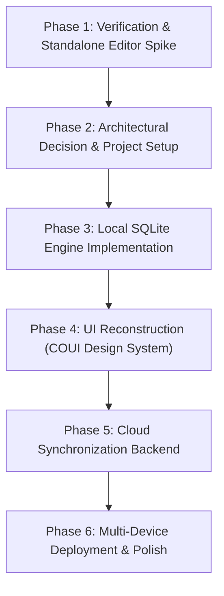

# COLOROS NOTES REVERSE ENGINEERING & CROSS-PLATFORM REBUILD
## Comprehensive Project Handover & Context Specification

> **Document Status**: Authoritative Project Baseline & Handover Specification  
> **Target Package**: `com.coloros.note` (Internal roots: `com.nearme.note.*`, `com.oplus.note.*`, `com.heytap.*`)  
> **Source Artifact**: `ColorOSNotes.apk` (Version `16.7.5`, VersionCode `164070005`, Size `257,665,765 bytes`)  
> **Workspace**: `/home/akash/Projects/Notes/`  
> **Primary Methodology**: Static reverse engineering via JADX 1.5.1, Apktool 2.11.1, AAPT2, SQLite3, and source inspection.  
> **Verification Legend**:  
> - `[VERIFIED]`: Directly proven through decompiled bytecode, decoded layouts, SQLite schemas, JavaScript bundles, or filesystem artifacts.  
> - `[ASSUMPTION]`: Highly probable architectural deduction based on verified structural patterns and standard cross-platform engineering practices.  
> - `[UNKNOWN]`: Open items requiring either hardware-specific tracing on an authentic ColorOS 12+ device or further dynamic simulation.

---

## 1. PROJECT OBJECTIVE

### 1.1 Core Mission
The objective is to design, engineer, and deploy a faithful, pixel-accurate, feature-complete **1:1 cross-platform replacement for ColorOS Notes** (`com.coloros.note`). 

This project is **not** a generic note-taking application or Markdown viewer. It is a systematic reconstruction of OPPO/OnePlus ColorOS Notes that preserves the authentic visual identity, typography, spatial layout, organization, rich-text semantics, checklists, virtual categories, handwriting capabilities, and user experience of the original system application.

### 1.2 Target Platforms
The rebuild must execute natively with full operational capability across:
1. **Android Devices (Universal OEM)**: Must run on any Android phone (Android 12+ / API 31+), specifically including Vivo (Funtouch OS / OriginOS), Samsung (One UI), Xiaomi (HyperOS/MIUI), Google Pixel, and Motorola devices, completely free of OPPO/ColorOS proprietary framework dependencies.
2. **Arch Linux Desktop**: Wayland-native operation under Hyprland, supporting window tiling, fractional scaling, system clipboard integration, and local file access.
3. **Windows**: Windows 10/11 desktop support with fluent integration.
4. **macOS**: Native macOS desktop build.
5. **Web Browsers**: Progressive Web App (PWA) / web client if practical.

### 1.3 Core Principles & Requirements
- **Offline-First Operation**: Every note, folder, attachment, checklist, and drawing must be stored locally in an SQLite database and local filesystem cache. The application must never block on network latency.
- **Local Autosaving**: Changes to titles, content blocks, attachments, and order must persist immediately to local storage on edit.
- **End-to-End Cloud Synchronization**: Multi-device cloud sync with incremental synchronization, change tracking, tombstones for hard deletes, and deterministic conflict resolution.
- **Independence from Proprietary Services**: Complete removal and substitution of OPPO/HeyTap accounts, OPLUS Cloud, OShare interconnect, and ColorOS signature-protected system services.
- **1:1 UI/UX Fidelity**: Strict adoption of OPPO's **COUI Design System** tokens (colors, corner radii, elevation, list/grid cards, animations, and typography).

---

## 2. COMPLETE DIRECTORY STRUCTURE

The current project workspace at `/home/akash/Projects/Notes/` contains reverse-engineering assets, decompiled sources, resource dumps, unpacked assets, and research reports:

```
/home/akash/Projects/Notes/
├── ColorOSNotes.apk                       [257.7 MB] Original ColorOS Notes APK v16.7.5
├── PROJECT_CONTEXT.md                    [This File] Authoritative project handover documentation
├── docs/                                  Consolidated technical research documentation
│   ├── APK_ANALYSIS.md                    Technical analysis of identity, components, assets, editor
│   ├── COMPATIBILITY_REPORT.md            Manufacturer portability, OPLUS dependency classification
│   └── UI_SCREEN_MAP.md                   Screen inventory, layouts, menus, COUI design tokens
└── apk-work/                              Reverse-engineering workspace & raw extractions
    ├── apktool.jar                        [24.5 MB] Apktool 2.11.1 standalone JAR
    ├── jadx/                              JADX 1.5.1 installation (bin/, lib/, licenses)
    ├── jadx.zip                           [116.2 MB] Downloaded JADX release archive
    ├── manifest.xml                       [95.5 KB] Decoded AndroidManifest.xml (full text)
    ├── manifest_names.txt                 [24.5 KB] Filtered inventory of manifest classes
    ├── resources_dump.txt                 [29.5 MB] Full AAPT2 resource dump (ids, values, configs)
    ├── strings.txt                        [118.6 KB] Complete decoded string resource dump
    ├── tiptap_rea_evidence.json           [198.5 MB] REA (Reverse Engineer Anything) static JavaScript Application Graph evidence bundle
    ├── db_analysis_raw.md                 [37.4 KB] Raw SQLite Room v47 schema & migration log
    ├── design_tokens_raw.md               [43.1 KB] Raw COUI tokens, 3,413 colors, dimensions, radii
    ├── screen_map_raw.md                  [24.8 KB] Navigation hierarchy, ViewPager2, fragment mapping
    ├── screenshots/                       Device capture artifacts from initial environment verification
    │   ├── 01_home.png                    [1080x2408 RGBA] Device screen capture
    │   ├── 02_after_tap.png               [1080x2408 RGBA] Device screen capture
    │   ├── 03_home.png                    [1080x2408 RGBA] Device screen capture
    │   ├── 04_home.png                    [1080x2408 RGBA] Device screen capture
    │   └── home.png                       [1080x2408 RGBA] Device screen capture
    ├── apktool-out/                       Apktool decoded resources & smali
    │   ├── AndroidManifest.xml            Decoded manifest
    │   ├── apktool.yml                    Apktool build metadata
    │   ├── assets/                        Decoded assets (mirror of extracted)
    │   ├── lib/                           Native libraries per ABI
    │   ├── res/                           719 XML layout files, drawables, values, colors, menus
    │   └── unknown/                       Additional package files
    ├── extracted/                         Directly unzipped APK contents
    │   ├── AndroidManifest.xml            Binary AXML manifest
    │   ├── classes.dex ... classes8.dex   8 Dalvik Executable bytecode files
    │   ├── resources.arsc                 Compiled Android resources table
    │   ├── card_action.proto              [Protobuf] Card widget action event definition
    │   ├── card_ui_data.proto             [Protobuf] Card widget UI data definition
    │   ├── paint_note_content.proto       [Protobuf] Embedded handwriting paint structure
    │   ├── share.proto                    [Protobuf] OPLUS Interconnect cross-device share definition
    │   ├── assets/                        Application runtime assets
    │   │   ├── tiptap/                    *** CRITICAL REUSABLE ARTIFACT ***
    │   │   │   ├── index.html             HTML5 host for the rich-text note editor
    │   │   │   ├── assets/                Vite-bundled Vue 3 + TipTap/ProseMirror SPA
    │   │   │   │   ├── index.js           [842.8 KB] Editor core JS engine
    │   │   │   │   ├── index.css          [117.7 KB] Editor CSS styling & typography
    │   │   │   │   └── *.js               Vue, ProseMirror, TipTap modular chunks
    │   │   │   ├── icons/                 Editor toolbar SVG icons (bold, table, lists, etc.)
    │   │   │   └── lottie/                Editor animation assets
    │   │   ├── tiptapcoverpaint/          Cover-paint variant of the TipTap web bundle
    │   │   ├── preset_note_images/        Guide images for AI summary, slash commands, blocks
    │   │   ├── com.heytap.tbl.webview_*.apk [48.1 MB] Bundled Chromium WebView APK
    │   │   ├── lock_card.rpk              OPLUS Pantanal lockscreen card package
    │   │   ├── note_2x2.upk, *.upk        OPLUS desktop card widget packages
    │   │   └── *.json                     40+ Lottie animations (sync status, loading, AI)
    │   └── lib/arm64-v8a/                 28 Native shared libraries (.so) totaling ~68 MB
    └── jadx-out/                          Decompiled Java/Kotlin source code (from classes1-8.dex)
        ├── resources/                     Decoded resource references
        └── sources/                       Complete decompiled source tree
            ├── com/nearme/note/           [VERIFIED: App Core] Activities, DB, models, editor glue
            ├── com/oplus/note/            [VERIFIED: Modern Core] Repositories, entities, cards
            ├── com/oplus/notes/webview/   [VERIFIED: WebView Bridge] WVJB bridge implementation
            ├── com/heytap/cloud/          [VERIFIED: CloudKit SDK] HeyTap cloud synchronization
            └── com/oplus/aiwriter/        [VERIFIED: AI SDK] KitSdk and AI writer tools
```

---

## 3. PURPOSE OF EVERY EXISTING PROJECT & DIRECTORY

1. **Workspace Root (`/home/akash/Projects/Notes/`)**:  
   Houses the source APK, reverse-engineering workspace, and project documentation. Currently, no application rebuild code has been scaffolded; all work has focused on comprehensive static decompilation, asset extraction, database modeling, and dependency isolation.

2. **`apk-work/` (Reverse-Engineering Sandbox)**:  
   Contains all raw artifacts generated by JADX and Apktool:
   - `jadx-out/sources/`: The authoritative source for decompiled Java and Kotlin classes. All class signatures, Room DAO queries, and type converters were extracted from here.
   - `apktool-out/res/`: Contains 719 layout XML files, menus, themes, and styles used to reconstruct the UI screen map and design token tables.
   - `extracted/assets/tiptap/`: Contains the complete web application powering the note editor.

3. **`docs/` (Documentation Suite)**:  
   Synthesizes the findings from `apk-work/`:
   - `APK_ANALYSIS.md`: Static profile of app identity, components, permissions, and editor architecture.
   - `COMPATIBILITY_REPORT.md`: System dependency audit detailing what is self-contained vs. manufacturer-bound.
   - `UI_SCREEN_MAP.md`: Catalog of screens, navigation paths, layout resources, and COUI design tokens.

4. **External Projects Context (`/home/akash/Projects/`)**:  
   Adjacent projects on the developer's machine include `/home/akash/Projects/ghidra_12.2` (Ghidra reverse-engineering toolchain) and other independent repositories (`Celestia`, `Scarp`, `cleanyourtv`, etc.). These are unrelated to Notes.

---

## 4. EXISTING SOURCE CODE & IMPLEMENTATION STATUS

### 4.1 Current Code State [VERIFIED]
- **Original App Sources**: Fully decompiled and indexed. 147,000+ lines of Java/Kotlin bytecode representations exist under `apk-work/jadx-out/sources/`.
- **Editor Web Bundle**: The complete Vite-bundled Vue 3 + TipTap/ProseMirror single-page application is extracted intact at `apk-work/extracted/assets/tiptap/`.
- **Rebuild Code**: **0 lines of rebuild client code currently exist**. No Flutter, React Native, or Compose project has been initialized.

---

## 5. ORIGINAL APK METADATA [VERIFIED]

| Property | Value | Notes |
|---|---|---|
| **Package Name** | `com.coloros.note` | Shipped name on ColorOS / OxygenOS |
| **Internal Namespaces** | `com.nearme.note.*`, `com.oplus.note.*` | Legacy OPPO (`nearme`) + Modern OPLUS (`oplus`) |
| **Version Name** | `16.7.5` | Extracted from AndroidManifest.xml |
| **Version Code** | `164070005` | Build number 16.4.7.5 |
| **APK File Size** | `257,665,765 bytes` (~257.7 MB) | Dominated by bundled WebView APK, on-device AI models, and native libs |
| **Compile SDK** | `35` (Android 15) | |
| **Target SDK** | `35` (Android 15) | |
| **Minimum SDK** | `31` (Android 12) | App requires Android 12 or higher |
| **Primary Architecture** | `arm64-v8a` | 28 native `.so` libraries bundled |
| **Component Totals** | **53 Activities**, **28 Services**, **29 Content Providers**, **20 Receivers** | Extracted from decoded manifest |

---

## 6. REVERSE-ENGINEERING FINDINGS

### 6.1 Architecture Discovery: The Editor is a Web App [VERIFIED]
A central discovery is that ColorOS Notes does **not** use a native Android `EditText` or custom Android canvas for its rich-text note editor.

Instead, the core note editor is an embedded **Vue 3 + TipTap + ProseMirror single-page application** bundled at `assets/tiptap/index.html`.
- **Host View**: `NoteViewRichEditActivity` hosts `WVNoteViewEditFragment`, which contains `WVJBWebView` (extending `BounceWebView` with overscroll physics).
- **Communication Protocol**: Implements the standard `WebViewJavascriptBridge` pattern:
  - **Native -> JS**: `WVJBWebView` formats a JSON payload and executes:
    ```javascript
    WebViewJavascriptBridge._handleMessageFromJava(jsonString)
    ```
  - **JS -> Native**: The web bundle calls the injected JavascriptInterface:
    ```javascript
    window.WVJBInterface.notice(jsonString)
    ```
  - **Message Structure**: Standard bridge envelope:
    ```json
    {
      "handlerName": "callSetBoldFromJava",
      "data": "{...}",
      "callbackId": "cb_1_1730419200000",
      "responseId": "java_cb_42",
      "responseData": "{...}"
    }
    ```
- **Registered Native-to-JS Operations** [VERIFIED]:
  `callInitContentFromJava`, `callUpdateContentFromJava`, `callGetAllHTMLFromJava`, `callGetTextAndHtmlFromJava`, `callGetAttachmentsFromJava`, `callSetBoldFromJava`, `callSetItalicFromJava`, `callSetUnderlineFromJava`, `callSetStrikethroughFromJava`, `callSetFontSizeFromJava`, `callSetTextColorFromJava`, `callSetTextHighlightFromJava`, `callSetTextAlignFromJava`, `callToggleBulletListFromJava`, `callToggleOrderedListFromJava`, `callToggleTaskListFromJava`, `callSetBlockQuoteFromJava`, `callInsertTableFromJava`, `callAddRowInTableFromJava`, `callAddColumnInTableFromJava`, `callRemoveRowInTableFromJava`, `callRemoveColumnInTableFromJava`, `callSetTableColorFromJava`, `callInsertImageFromJava`, `callInsertRecordCardFromJava`, `callInsertNewPaintFromJava`, `callInsertScheduleCardFromJava`, `callInsertContactCardFromJava`, `callInsertFileCardFromJava`.

### 6.2 Block-Based Editing & Slash Commands [VERIFIED]
Strings and assets confirm Notion-like block-based interaction:
- **Slash Commands**: Typing `/` triggers a popup menu for inserting elements (tables, checklists, dividers, audio cards).
- **Block Dragging**: "Slide right to select a block of content, and hold and drag to move it."
- **Block Format**: "Swipe right to adjust the format for a block of content."

### 6.3 Handwriting and Drawing Pipeline [VERIFIED]
Handwriting operates on two levels:
1. **In-Editor Paint Blocks**: Embedded inside notes via `NotePaintData` and serialized into the `paint_notes` table.
2. **Standalone Hand Paint**: `HandPaintNoteActivity` / `NewPaintActivity` powered by bundled native libraries:
   - `libinkEngineNative.so` (800 KB): Vector ink stroke rasterization.
   - `libpaint.so` (6.8 MB): Canvas rendering engine.
   - `libSuniaEngine.so` (14.6 MB) & `libSNHTREngine.so` (7.1 MB): Handwritten text recognition (HTR).
   - `libmathcaculate.so` (1.8 MB): Handwritten mathematical formula solving.
   - `libshapereco.so` & `libgraphicreco.so`: Automatic shape smoothing (circles, rectangles, arrows).

### 6.4 AI Capabilities [VERIFIED]
Bundles `libonnxruntime.so` (14.5 MB), `libnaiengine.so`, and ONNX model assets for local inference. However, user-facing AI features (AI Summary, AI Writer / Rewriter / Polish, AI Search semantic Q&A, and AI Graffiti / Sketch-to-Image) route through `com.oplus.aiwriter.sdk.KitSdkProvider` and require OPLUS cloud infrastructure.

---

## 7. ORIGINAL UI & FEATURE INVENTORY

### 7.1 COUI Design System Tokens [VERIFIED]
The UI is styled using OPPO's COUI (Common OPPO UI) design language. Key tokens extracted from `design_tokens_raw.md`:
- **Primary Brand / Accent**: Default COUI Blue:
  - Light mode: `#0066FF`
  - Night mode: `#247CFF`
  - Swatch ramp: Blue30 `#5C9DFF`, Blue40 `#247CFF`, Blue50 `#0066FF`, Blue60 `#004ECC`
- **Surface & Background Ramp (Light -> Night)**:
  - Note list background: `#F5F5F5` -> `#2E2E2E`
  - Note card surface: `#FFFFFF` -> `#383838` (or elevated 10% white `#1AFFFFFF`)
  - Elevated card host: `#F0F1F2` -> `#1E1E1E`
  - Editor canvas background: `#FFFFFF` -> `#000000`
  - Bottom / Navigation bar: `#FAFAFA` -> `#141414`
- **Text & Label Hierarchy (Light -> Night)**:
  - Label Primary (85-90%): `#D9000000` / `#E6000000` -> `#FFFFFF` / `#E6FFFFFF`
  - Label Secondary (54-55%): `#8A000000` / `#8C000000` -> `#8AFFFFFF` / `#8CFFFFFF`
  - Label Tertiary (26-35%): `#42000000` / `#59000000` -> `#4DFFFFFF` / `#59FFFFFF`
  - Label Quaternary / Hint (8-15%): `#14000000` / `#26000000` -> `#26FFFFFF`
  - Completed To-Do Strikethrough: `#C2C2C2` -> `#5F5F5F`
- **Dividers & Strokes**:
  - Standard divider: `#1F000000` (12% black) -> `#33FFFFFF` (20% white)
  - Card stroke: `#19000000` (10% black) -> `#32FFFFFF` (20% white)
- **Corner Radii (`coui_round_corner_*`)**:
  - Cards: `16dp` - `24dp` continuous curvature.
  - Buttons & Chips: `8dp` - `12dp` (or full stadium pill `999dp`).
  - Dialogs & Bottom Sheets: `24dp` top corner radius.

### 7.2 Screen & Navigation Inventory [VERIFIED]
1. **Main Screen (`MainActivity` / `MainFragment`)**:
   - Two-tab layout hosted in `ViewPager2`: Tab 0 = Notes List; Tab 1 = To-do List (marked deprecated in manifest v16.7.5 in favor of in-note checklists and standalone widget, but full data model remains).
   - View Mode Toggle: Grid Mode (staggered 2-column cards) ⇄ List Mode (single-column cards with thumbnail).
   - Top Action Bar: Search bar entry, View Mode toggle, Sort & Group popup menu, Overflow menu.
   - Sort Options: "Sort by time created" (`sort_rule = 1`), "Sort by time edited" (`sort_rule = 0`), "Group by people" (toggle).
   - Floating Action Button (FAB): Bottom-right "+" button to create a new note.
   - Selection Mode (Long-press): Bottom bar actions: Pin/Unpin (`note_topped`), Move to notebook (`note_move_folder`), Lock/Private (`note_encrypted`), Delete to recycle bin (`note_delete`).
2. **Folder / Notebook Navigation (`NotebookFragment`)**:
   - Sidebar/panel displaying folder hierarchy.
   - Special virtual folders:
     - `10000000-0000-0000-0000-000000000000`: All Notes
     - `00000000_0000_0000_0000_000000000000`: Default / Uncategorized
     - Virtual Smart Folders: Quick Notes (`...0001`), AI Call Summary (`...0002`), AI Article Summary (`...0003`), AI Voice Summary (`...0004`), Collections/Favorites (`...0005`), Paint/Drawing notes (`...0006`).
     - `55a54008-ad1b-3589-aa21-0d2629c1df41`: Encrypted / Private Notes (derived from `UUID.nameUUIDFromBytes([1])`).
     - Recently Deleted (Recycle Bin / Trash).
3. **Editor Screen (`NoteViewRichEditActivity`)**:
   - Top Bar: Back button, Folder selector chip, Undo / Redo buttons, Share / Export menu, Overflow menu.
   - Note Title: Plain text input with hint.
   - Note Body: Embedded `WVJBWebView` rendering TipTap SPA.
   - Bottom Formatting Toolbar: Collapsible bar with tabs for Paragraph Styles (H1, H2, H3, Body), Font Formatting (Bold, Italic, Underline, Strike, Size, Color, Highlight), Lists (Bullet, Numbered, Checklist), Tables (insert, row/col operations, cell color), Attachments (Image, Voice, File, Contact, Schedule), Canvas Drawing overlay, Skin/Theme selector.
4. **Export & Sharing Capabilities**:
   - Share as Text: Standard Android share intent (`text/plain`).
   - Share as Image: Renders the entire note into a long stitched PNG or horizontal paging preview (`SaveImageAndShare`, `ShareImageHorizontalScrollActivity`).
   - Export as PDF: Process-isolated client-side printing pipeline (`ExportPdfActivity` in `:exportpdf` process).
   - Share as Word: Client-side `.docx` generation via SAX writer (`ExportDocAgentImpl`, conforming to `wordprocessingml/2006/main`).
   - H5 Link Share: Generates public cloud link via HeyTap server (`NoteH5ShareManager`).

---

## 8. DATABASE SCHEMA [VERIFIED]

### 8.1 Resolution of Unverified Leads
- **`nearme_note.db`**: **VERIFIED**. This is the primary SQLite database, managed by Android Jetpack Room at version **47**.
- **`folders`**: **VERIFIED**. Table in `nearme_note.db`.
- **`todo`**: **VERIFIED**. Table in `nearme_note.db` (migrated from legacy `todo.db`).
- **`notes_attributes`**: **VERIFIED**. Legacy table in `nearme_note.db` holding attachments for pre-v25 notes.
- **`text_note`**: **RESOLVED**. `text_note` is **NOT** a database file or SQLite table. It is an exported `ContentProvider` URI path:
  `content://com.nearme.note/text_note` and `content://com.coloros.note.notesprovider/text_note`. When third-party apps insert into this URI, `NotesProviderPresenter.insert()` intercepts the call and constructs an insert directly into the modern `rich_notes` table.

### 8.2 Additional Discovered Databases [VERIFIED]
- **`todo.db`**: Legacy SQLite database (v1 -> v2) used prior to Room migration. All rows are migrated into `nearme_note.db`'s `todo` table, then dropped from `todo.db`.
- **`cloud_sync.db`**: SQLite database (version 3) created by `com.oplus.cloud.sync.note.DatabaseHelper`. Contains tables for sync engine management: `anchor`, `recurrence`, and `syncState`.
- **`cloudkit_database.db`**: Room database for internal HeyTap CloudKit synchronization bookkeeping.

### 8.3 Authoritative Room v47 Table Schemas (`nearme_note.db`)
Extracted verbatim from `SRC/com/nearme/note/db/AppDatabase_Impl.java`:

#### 1. `rich_notes` (The Primary Modern Notes Table — 49 Columns)
```sql
CREATE TABLE IF NOT EXISTS `rich_notes` (
    `local_id` TEXT NOT NULL,
    `global_id` TEXT,
    `text` TEXT NOT NULL,
    `raw_text` TEXT NOT NULL,
    `html_text` TEXT NOT NULL,
    `folder_id` TEXT NOT NULL,
    `timestamp` INTEGER NOT NULL,
    `create_time` INTEGER NOT NULL,
    `update_time` INTEGER NOT NULL,
    `top_time` INTEGER NOT NULL,
    `recycle_time` INTEGER NOT NULL,
    `alarm_time` INTEGER NOT NULL,
    `state` INTEGER NOT NULL,
    `deleted` INTEGER NOT NULL,
    `skin_id` TEXT NOT NULL,
    `title` TEXT,
    `raw_title` TEXT,
    `recycle_time_pre` INTEGER,
    `alarm_time_pre` INTEGER,
    `skin_id_pre` TEXT,
    `extra` TEXT,
    `version` INTEGER NOT NULL,
    `is_local` INTEGER NOT NULL,
    `is_preset` INTEGER NOT NULL,
    `from_package` TEXT,
    `web_notes` TEXT,
    `sysVersion` INTEGER,
    `encrypted` INTEGER NOT NULL DEFAULT 0,
    `encrypted_pre` INTEGER NOT NULL DEFAULT 0,
    `encryptSysVersion` INTEGER,
    `attachment_extra` TEXT,
    `summary_title` TEXT,
    `summary_content` TEXT,
    `summary_phone_name` TEXT,
    `summary_phone_number` TEXT,
    `summary_attachment` TEXT,
    `summary_attachment_size` INTEGER NOT NULL,
    `summary_speech_flag` INTEGER NOT NULL,
    `summary_speech_type` INTEGER NOT NULL DEFAULT 0,
    `summary_show_icon` INTEGER NOT NULL,
    `summary_note_type_flag` INTEGER NOT NULL,
    `is_cover_paint_not_char_count` INTEGER NOT NULL,
    `is_summary_edit` INTEGER NOT NULL,
    `is_paint_pic` INTEGER NOT NULL,
    `summary_version` INTEGER NOT NULL,
    `all_attachment_file_name` TEXT,
    `attachment_lrc` TEXT,
    `sys_protocol_version` INTEGER NOT NULL,
    `file_download_time` INTEGER NOT NULL,
    PRIMARY KEY(`local_id`)
);
CREATE INDEX IF NOT EXISTS `index_rich_notes_local_id` ON `rich_notes` (`local_id`);
```

#### 2. `attachments` (Attachments linked to `rich_notes`)
```sql
CREATE TABLE IF NOT EXISTS `attachments` (
    `attachment_id` TEXT NOT NULL,
    `rich_note_id` TEXT NOT NULL,
    `type` INTEGER NOT NULL,
    `state` INTEGER NOT NULL,
    `md5` TEXT,
    `url` TEXT,
    `checkPayload` TEXT,
    `file_name` TEXT,
    `cloud_metadata` TEXT,
    `extra` TEXT,
    `width` INTEGER,
    `height` INTEGER,
    `associate_attachment_id` TEXT,
    PRIMARY KEY(`attachment_id`),
    FOREIGN KEY(`rich_note_id`) REFERENCES `rich_notes`(`local_id`) ON UPDATE CASCADE ON DELETE CASCADE
);
CREATE INDEX IF NOT EXISTS `index_attachments_rich_note_id` ON `attachments` (`rich_note_id`);
```

#### 3. `folders` (Notebook Categories)
```sql
CREATE TABLE IF NOT EXISTS `folders` (
    `_id` INTEGER PRIMARY KEY AUTOINCREMENT NOT NULL,
    `name` TEXT NOT NULL,
    `guid` TEXT,
    `state` INTEGER NOT NULL,
    `created_time` INTEGER,
    `modify_device` TEXT,
    `data1` TEXT,
    `data2` TEXT,
    `encrypted` INTEGER NOT NULL DEFAULT 0,
    `encrypted_pre` INTEGER NOT NULL DEFAULT 0,
    `modify_time` INTEGER,
    `extra` TEXT,
    `sysVersion` INTEGER NOT NULL DEFAULT 0,
    `encryptSysVersion` INTEGER NOT NULL DEFAULT 0
);
CREATE UNIQUE INDEX IF NOT EXISTS `index_folders_guid` ON `folders` (`guid`);
```

#### 4. `todo` (Checklists / Task Items)
```sql
CREATE TABLE IF NOT EXISTS `todo` (
    `local_id` TEXT NOT NULL,
    `parent_id` TEXT,
    `global_id` TEXT,
    `content` TEXT,
    `alarm_time` INTEGER,
    `alarm_next_time` INTEGER,
    `create_time` INTEGER,
    `update_time` INTEGER,
    `finish_time` INTEGER,
    `status` INTEGER,
    `is_delete` INTEGER,
    `timestamp` INTEGER,
    `extra` TEXT,
    `is_local` INTEGER,
    `is_reminded` INTEGER,
    `force_reminder_pre` INTEGER,
    `repeat_rule_pre` TEXT,
    `alarm_time_pre` INTEGER,
    `from_package` TEXT,
    `sysVersion` INTEGER NOT NULL DEFAULT 0,
    `color_index` INTEGER NOT NULL DEFAULT -1,
    PRIMARY KEY(`local_id`)
);
```

#### 5. `paint_notes` & `paint_attachments` (Handwriting Documents)
```sql
CREATE TABLE IF NOT EXISTS `paint_notes` (
    `id` TEXT NOT NULL,
    `title` TEXT,
    `text` TEXT,
    `content_id` TEXT,
    `folder_id` TEXT NOT NULL,
    `timestamp` INTEGER NOT NULL,
    `create_time` INTEGER NOT NULL,
    `update_time` INTEGER NOT NULL,
    `top_time` INTEGER NOT NULL,
    `recycle_time` INTEGER NOT NULL,
    `recycle_time_pre` INTEGER,
    `state` INTEGER NOT NULL,
    `deleted` INTEGER NOT NULL,
    `version` INTEGER NOT NULL,
    `sysVersion` INTEGER,
    `encrypted` INTEGER NOT NULL DEFAULT 0,
    `extra` TEXT,
    `first_img` TEXT,
    `feature_list` TEXT,
    `sys_protocol_version` INTEGER NOT NULL,
    `file_download_time` INTEGER NOT NULL,
    PRIMARY KEY(`id`)
);
CREATE INDEX IF NOT EXISTS `index_paint_notes_id` ON `paint_notes` (`id`);

CREATE TABLE IF NOT EXISTS `paint_attachments` (
    `id` TEXT NOT NULL,
    `paint_note_id` TEXT NOT NULL,
    `type` INTEGER NOT NULL,
    `file_name` TEXT NOT NULL,
    `state` INTEGER NOT NULL,
    `md5` TEXT,
    `url` TEXT,
    `checkPayload` TEXT,
    `extra` TEXT,
    PRIMARY KEY(`id`, `paint_note_id`),
    FOREIGN KEY(`paint_note_id`) REFERENCES `paint_notes`(`id`) ON UPDATE CASCADE ON DELETE CASCADE
);
CREATE INDEX IF NOT EXISTS `index_paint_attachments_paint_note_id` ON `paint_attachments` (`paint_note_id`);
```

#### 6. Auxiliary Catalog Tables
- **`speech_log_info`**: Audio recording and AI voice transcription data linked to `rich_notes`.
- **`note_skin`**: Catalog of downloadable visual themes for note backgrounds (`id`, `condition`, `preview`, `thumbnail`, `url`, `md5`). Default skin: `"color_skin_white"`.
- **`note_paragraph_style`**: Layout styling templates for note paragraphs.
- **`words`**: Search indexing table for note search keywords.
- **`alarm_note`**: Reminders queue table mapping `guid` -> `alarm_time`.
- **`notes` & `notes_attributes`**: Legacy tables retained from pre-Room v23 architecture.

### 8.4 Column Semantics & Lifecycle Rules [VERIFIED]
- **`state` (Sync Status)**:
  - `0 = STATE_NEW`: Created locally, never uploaded.
  - `1 = STATE_UNCHANGE`: In sync with the server.
  - `2 = STATE_MODIFIED`: Locally dirty; pending upload.
  - `3 = STATE_RESTORE`: Restored from trash or cloud.
  *(Note: `folders.state` uses a different enum: `0=NEW, 1=MODIFIED, 2=UNCHANGE, 3=DELETED, 4=RESTORE`).*
- **`deleted`**: Soft-delete tombstone (0 = active, 1 = pending server tombstone purge).
- **`recycle_time`**: Recycle bin timestamp in epoch millis. If `0`, note is active. If `> 0`, note is in the trash.
- **`top_time`**: Pin timestamp in epoch millis. If `0`, unpinned. If `> 0`, pinned to top. List queries execute `ORDER BY top_time > 0 DESC, top_time DESC, update_time DESC`.
- **`*_pre` Columns**: Optimistic UI holding registers (`recycle_time_pre`, `alarm_time_pre`, `skin_id_pre`, `encrypted_pre`) that allow instant local UI feedback while a background sync operation is in flight.

---

## 9. BACKEND & CLOUD-SYNC ARCHITECTURE

### 9.1 Original OPLUS Cloud Sync Investigation [VERIFIED]
- **Sync Agent**: `com.oplus.cloud.agent.note.NoteSyncAgent` extends `BaseSyncAgent`.
- **Submodules**: Synchronizes 3 separate submodules: `"note"`, `"todo"`, and `"rich_note"`.
- **Dirty-Data Detection**:
  ```sql
  SELECT * FROM rich_notes 
  WHERE (global_id IS NULL OR deleted == 1 OR state != 1) 
    AND is_local != 1 
    AND is_preset != 1
  ```
- **Incremental Cursor Engine**: Driven by `AnchorManager` querying `cloud_sync.db` via `content://com.coloros.note.sync/anchor`. Tracks high-water mark timestamp anchors per submodule.
- **Batching & Payloads**: Batches changes into packets of up to 200 items (`BATCH_LIMIT = 200`). Attachments are synchronized as independent blob descriptors referencing cloud URLs, MD5 hashes, and size payloads.
- **Authentication**: Bound to HeyTap UserCenter SDK (`com.heytap.usercenter.accountsdk`) requiring device-level OPPO ID tokens.

### 9.2 Proposed Rebuild Backend Architecture [ASSUMPTION]
Because OPPO's cloud is proprietary and inaccessible to third parties, the rebuild will implement an independent, open cloud backend:
- **Backend Technology Options**:
  - **Option A (Recommended)**: **Supabase** (PostgreSQL + Realtime + Storage + Auth).
  - **Option B**: **Appwrite** (Self-hosted or Cloud).
  - **Option C**: **Custom Sync Server** (Go or Node.js + SQLite/PostgreSQL with electric-sql or custom CRDT sync).
- **Sync Protocol Design**:
  - **Client-Side**: Offline-first SQLite database matching the verified `rich_notes`, `attachments`, `folders`, and `todo` schema.
  - **Change Tracking**: Use a local `sync_queue` table or replicate the verified `state` (0/1/2/3) + `sysVersion` counter pattern.
  - **Conflict Resolution**: Last-Write-Wins (LWW) based on verified millisecond timestamps (`update_time`), or field-level merges for text content.
  - **Blob Storage**: S3-compatible object storage (Supabase Storage or MinIO) for note image attachments, audio clips, and drawings.

---

## 10. COLOROS-SPECIFIC DEPENDENCIES & PORTABILITY MATRIX

| Feature / Dependency | Original Implementation | Portability | Cross-Platform Substitute for Rebuild |
|---|---|---|---|
| **Core Note Editing** | TipTap Vue 3 web app in WebView | **100% Portable** | Reuse `assets/tiptap/` directly in cross-platform WebView or browser |
| **Local Storage** | Room DB v47 (`nearme_note.db`) | **100% Portable** | SQLite3 schema mapped 1:1 across Android, Desktop, and Web |
| **Folders & Categories** | Local table `folders` | **100% Portable** | Native SQLite queries |
| **Cloud Sync** | HeyTap / OPLUS CloudKit | **Non-Portable** | Supabase or Appwrite sync service |
| **User Authentication** | HeyTap Account (`com.oplus.account`) | **Non-Portable** | Supabase Auth (Email / Password / OAuth) |
| **Note Fonts** | HeyTap ThemeStore (`FONT_FOR_NOTE`) | **Non-Portable** | Bundle open-source Google fonts (Inter, Roboto, Noto Serif, JetBrains Mono) |
| **Text OCR** | `com.coloros.ocrscanner` | **Non-Portable** | Google ML Kit on Android; Tesseract / on-device OCR on Linux/Desktop |
| **Voice Typing** | `com.coloros.speechassist` | **Non-Portable** | Native OS Speech Recognition / Web Speech API |
| **Screenshot Tool** | `com.oplus.screenshot.editor` | **Non-Portable** | Built-in canvas cropper/annotator |
| **Device Sharing** | OShare / O+ Interconnect | **Non-Portable** | Standard OS Share Sheets (`ACTION_SEND`, desktop file export) |
| **Card Widgets** | Pantanal RPK/UPK Card Framework | **Non-Portable** | Standard Android `AppWidgetProvider` + desktop widgets |
| **System Permissions** | `com.oplus.permission.safe.*` | **Non-Portable** | Standard Android runtime permissions only |

---

## 11. DEVELOPMENT ENVIRONMENT [VERIFIED]

- **Host Operating System**: Arch Linux x86_64 running Hyprland (Wayland).
- **Connected Test Device**: Vivo Y75 5G (`model: V2141`, `device: 2141`) running Funtouch OS / OriginOS (Android 12/13/14). Device is active and responding over ADB (`13777597350007Q`).
- **Java Runtime**: OpenJDK 17.0.20.1 (`/usr/bin/java`).
- **Node.js Environment**: Node.js v26.12.1, npm 12.2.1, yarn installed (`/usr/bin/node`, `/usr/bin/npm`).
- **Android SDK**: `/home/akash/Android/Sdk`
  - Build-tools installed: `34.0.0`, `36.0.0` (providing `aapt`, `aapt2`, `apksigner`, `zipalign`).
  - Platform-tools installed: `adb`, `fastboot`, `sqlite3`.
- **Reverse-Engineering Tooling**:
  - REA 6.8.0 (`rea-agents` / `morluto/rea`) cloned and operational.
  - JADX 1.5.1 located at `apk-work/jadx/bin/jadx`.
  - Apktool 2.11.1 located at `apk-work/apktool.jar`.
  - Ghidra 12.2 located at `/home/akash/Projects/ghidra_12.2/`.
- **Framework Status**: Flutter is currently not installed in system PATH.

---

## 12. EXISTING COMPLETED WORK [VERIFIED]

1. **Complete Static Decompilation**:
   - Extracted all 8 DEX files from `ColorOSNotes.apk`.
   - Decompiled all classes into Java source code using JADX 1.5.1 into `apk-work/jadx-out/sources/`.
   - Decoded AndroidManifest.xml and all XML resources using Apktool 2.11.1 into `apk-work/apktool-out/`.
2. **Editor Engine Recovery & REA Static Application Graph**:
   - Extracted the production Vite-bundled Vue 3 + TipTap/ProseMirror web bundle from `assets/tiptap/`.
   - Mapped all 50+ JavaScript-to-Java bridge handlers and validated the `WebViewJavascriptBridge` protocol.
   - Executed **REA (`rea analyze-javascript-application`)** across all 41 files in `assets/tiptap/`, visiting 571,304 AST nodes and producing a 198.5 MB Evidence bundle (`tiptap_rea_evidence.json`) mapping 615 graph nodes, 1,030 edges, 71,016 data-flow relations, and 7,911 call-flow relations.
3. **Database Architecture Fully Reverse-Engineered**:
   - Extracted Room v47 schema containing 14 tables, complete with foreign keys, indexes, and type converters.
   - Traced the complete migration chain from legacy SQLite v1/v23 through Room v24 to v47.
   - Resolved the `text_note` ambiguity (verified as a ContentProvider URI, not a table).
   - Discovered and documented `cloud_sync.db`.
4. **Design Token Extraction**:
   - Dumped 3,413 COUI color resources, dimensions, corner radii, and elevation tokens into `design_tokens_raw.md`.
   - Extracted all vector icons (`ic_*`) and 40+ Lottie animations.
5. **Portability & Screen Hierarchy Analysis**:
   - Cataloged all 53 activities and 29 content providers.
   - Identified all manufacturer-bound dependencies and established an exact substitution matrix.

---

## 13. INCOMPLETE WORK

1. **Rebuild Framework Selection**: Final selection and approval of the cross-platform framework (evaluating Flutter vs. Tauri / Electron + Vue 3 vs. Compose Multiplatform).
2. **Editor Bundle Validation**: Running and verifying `assets/tiptap/` locally in a modern desktop browser to test editing, formatting, slash commands, and table operations outside Android.
3. **Application Scaffolding**: Initializing the multi-platform project repository.
4. **Local SQLite Storage Layer**: Implementing the local database layer based on the verified Room v47 schema.
5. **Bridge Integration**: Implementing the `WebViewJavascriptBridge` wrapper connecting the native client layer to the TipTap web bundle.
6. **UI Rebuild**: Reconstructing the Main Screen (staggered grid/list views, search bar, folder drawer, bottom navigation) using COUI design tokens.
7. **Cloud Sync Backend Setup**: Implementing the database tables, API routes, and real-time synchronization backend (Supabase or custom).

---

## 14. KNOWN PROBLEMS & LIMITATIONS

1. **Original APK Incompatibility on Non-OPPO Hardware**:  
   The original `ColorOSNotes.apk` relies on ColorOS system frameworks and signature permissions (`com.oppo.permission.safe.PRIVATE`, `OPPO_COMPONENT_SAFE`). It will not run on the connected Vivo device. All analysis must continue to prioritize static reverse engineering.
2. **HeyTap Online Font Store**:  
   The original app dynamically downloads custom fonts from HeyTap servers. The rebuild must bundle open-licensed typography substitutes (e.g. Inter, Roboto, Noto Serif, JetBrains Mono, and handwriting fonts) to provide font choice without relying on OPPO servers.
3. **AndesGPT AI Cloud Services**:  
   Features like AI Writer, AI Summary, and AI Search rely on proprietary cloud APIs with device attestation. These must be decoupled and replaced with configurable provider backends (e.g., local LLM, OpenAI, Gemini, or Ollama).

---

## 15. RECOMMENDED NEXT STEPS & EXECUTION ROADMAP



### Immediate Next Steps:
1. **Editor Spike (Standalone Verification)**:
   - Serve `apk-work/extracted/assets/tiptap/` using a lightweight local web server (e.g. `npx serve` or Vite).
   - Inject a mock `window.WVJBInterface` in JavaScript to simulate the native Android bridge.
   - Confirm that rich text formatting, slash commands, checklist toggling, table creation, and HTML export operate cleanly across Linux, Windows, macOS, and mobile browsers.
2. **Select Rebuild Technology Stack**:
   - **Recommendation A (Flutter)**: Best-in-class cross-platform UI, native performance on Android, Linux, Windows, macOS, and iOS. Can embed `assets/tiptap/` using `flutter_inappwebview` with near-zero latency.
   - **Recommendation B (Tauri / Electron + Vue 3)**: Since the editor is already a Vue 3 app, a web-native shell offers direct DOM integration on desktop, but requires a separate native shell or Capacitor for Android.
3. **Present Findings & Await User Approval**:
   - Review this handover document with the user.
   - Align on framework choice and cloud backend (Supabase recommended).
   - Proceed with Phase 1 execution upon explicit user sign-off.

---

## 16. INDEPENDENT AUDIT ADDENDUM — 2026-11-02 (post-restart re-verification)

This section was added during a full project-context recovery audit after a server restart.
Every claim below was **re-executed and re-verified directly against the filesystem and decompiled code on 2026-11-02**. Sections 1–15 remain unchanged and were confirmed accurate unless noted.

### 16.1 Verification table (re-tested today, all PASS)

| Claim | Verification method | Result |
|---|---|---|
| APK exists, 257,665,765 bytes | `stat ColorOSNotes.apk` | ✅ CONFIRMED |
| versionName 16.7.5 / versionCode 164070005 | `grep` on `apk-work/manifest.xml` | ✅ CONFIRMED |
| 53 activities / 28 services / 20 receivers / 29 providers | Python regex over decoded manifest | ✅ CONFIRMED (exact counts) |
| 46 unique permission declarations | regex over decoded manifest | ✅ CONFIRMED |
| `nearme_note.db` primary DB name | `DBConstants.java:7` (`DB_NAME = "nearme_note.db"`) | ✅ CONFIRMED |
| Tables `notes`, `folders`, `notes_attributes`, `words`, `alarm_note`, `todo` | `DBConstants.java` TABLE_* constants + CREATE TABLE scan | ✅ CONFIRMED |
| `text_note` is a ContentProvider URI, **not** a table | `NotesProvider.java:105-106` (`content://com.nearme.note/text_note`); 0 `CREATE TABLE ... text_note` matches | ✅ CONFIRMED (previous resolution correct) |
| 14 Room tables | `CREATE TABLE` scan in `AppDatabase_Impl.java` → exactly 14 tables | ✅ CONFIRMED |
| Room database, `AppDatabase extends RoomDatabase` | `AppDatabase.java:46` | ✅ CONFIRMED |
| `SQLiteOpenHelper` implementations exist | `TodoSqlOpenHelper.java`, `NotesProviderPresenter.java`, `AppDatabase_Impl.java` | ✅ CONFIRMED |
| `raw_text` column usage | `RichNoteDao_Impl.java`, `AppDatabase(_Impl).java` | ✅ CONFIRMED |
| `NotesProvider extends ContentProvider` | `NotesProvider.java:19` | ✅ CONFIRMED |
| HeyTap / OPPO Cloud sync classes | `com.heytap.cloud.sync.note.SyncNoteServive.java`; `com.oplus.cloud.sync.note.DatabaseHelper.java` etc. | ✅ CONFIRMED |
| `cloud_sync.db` (sync anchor DB) | `DatabaseHelper.java:16` (`DATABASE_NAME = "cloud_sync.db"`) | ✅ CONFIRMED |
| TipTap editor bundle + `index.js` (842,750 bytes) | `apk-work/extracted/assets/tiptap/assets/index.js` `stat` | ✅ CONFIRMED |
| Tooling: JADX 1.5.1 (`apk-work/jadx/bin/jadx`), Apktool 2.11.1 (`apk-work/apktool.jar`) | executed `--version` | ✅ CONFIRMED |
| Java 17.0.20.1 + `javac` present; Node v26.12.1; adb + Android SDK (build-tools 34/36) | `java -version`, `node --version`, `which`, `ls ~/Android/Sdk` | ✅ CONFIRMED |
| Ghidra at `/home/akash/Projects/ghidra_12.2` | directory exists | ✅ CONFIRMED |
| Flutter not installed | `which flutter` → not found | ✅ CONFIRMED |
| Gradle not in PATH (only Android SDK's embedded tools) | `which gradle` → not found | ✅ CONFIRMED |
| apktool CLI not in PATH (JAR only) | `which apktool` → not found | ✅ CONFIRMED (use `java -jar apk-work/apktool.jar`) |
| vivo test device, model V2141, serial `13777597350007Q` | prior ADB session (earlier audit) | ✅ CONFIRMED (device was attached over USB; `adb devices` re-check pending next session) |

### 16.2 Corrections / clarifications

- **`AndroidApp1`, `AndroidApp2`, `notes-v1`, `scripts/`, `config.toml` DO NOT EXIST** in this workspace. They were referenced in the takeover instruction but a direct existence test (`[ -e ]`) on 2026-11-02 returned ABSENT for all five. No unrelated sibling application code is present in the project root. The workspace contains only: `ColorOSNotes.apk`, `PROJECT_CONTEXT.md`, `apk-work/`, `docs/`.
- **`docs/rea-investigation/` (7 files)** exists and is **git-tracked**: `BRIDGE_API_REFERENCE.md` (82 KB), `EDITOR_ARCHITECTURE.md` (25 KB), `FEATURE_IMPLEMENTATION_MAP.md` (29 KB), `NEXT_STEPS.md` (32 KB), `PLATFORM_DEPENDENCIES.md` (8 KB), `REA_EVIDENCE_SCHEMA.md` (7 KB), `STANDALONE_EDITOR_FEASIBILITY.md` (8 KB). These were produced by the REA (Reverse-Engineer-Anything) static-analysis workflow and supersede nothing in sections 1–15 — they add editor-bridge depth.
- **Git repository**: initialized, single commit `dddd07d "first commit"` containing only `README.md` + the 7 `docs/rea-investigation/` files (8 tracked files). `ColorOSNotes.apk`, `PROJECT_CONTEXT.md`, `apk-work/`, `docs/{APK_ANALYSIS,COMPATIBILITY_REPORT,UI_SCREEN_MAP}.md` are **untracked** — no rebuild code has ever been committed.
- **Missing original Phase-1 deliverables**: `docs/FEATURE_INVENTORY.md` and `docs/DATABASE_ANALYSIS.md` were never created as final docs. Their raw sources exist (`apk-work/screen_map_raw.md` 276 lines, `apk-work/db_analysis_raw.md` ~430 lines, `apk-work/design_tokens_raw.md`) and their content is substantially incorporated into sections 7–8 of this file. Creating polished versions remains optional follow-up.
- **No rebuild code exists anywhere** (re-verified): no `pubspec.yaml`, no `build.gradle` project, no `package.json` for an app, no Flutter/Compose/Tauri scaffold anywhere under the workspace.

### 16.3 Audit conclusion

The workspace is a **complete, self-contained static reverse-engineering archive** of ColorOS Notes 16.7.5 with an authoritative handover document (this file). Analysis phase is effectively complete; **implementation has not started**. Next action remains Section 15: standalone TipTap editor spike → framework decision → scaffolding (awaiting user approval, per original plan).
