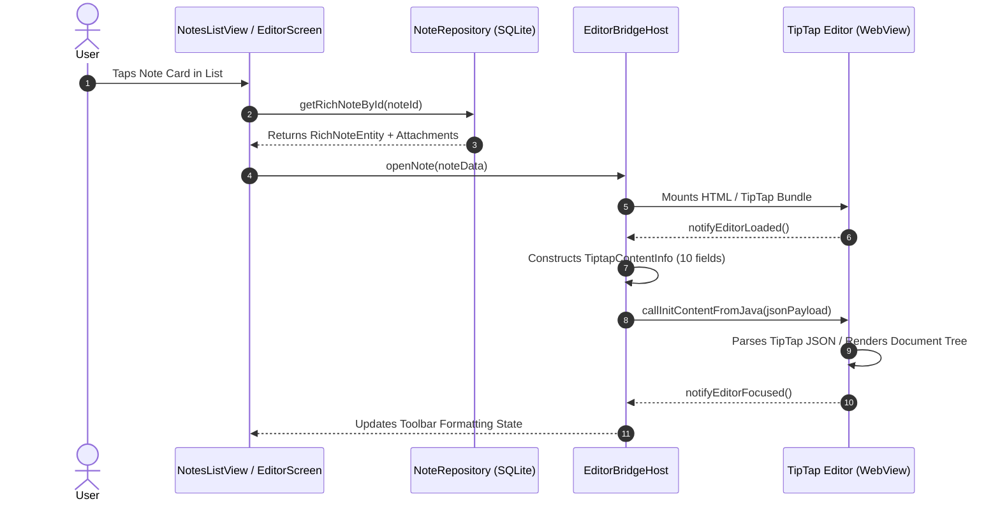
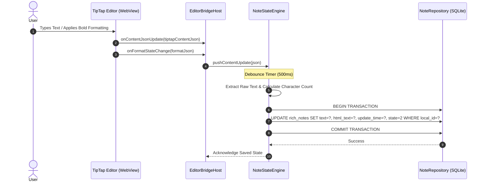
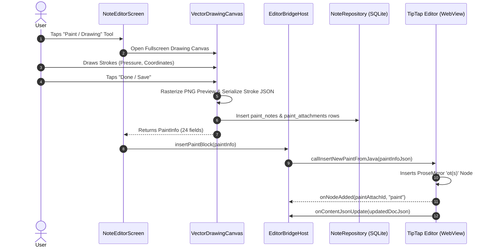

# Proposed System Architecture — Cross-Platform ColorOS Notes Replica

| Field | Value |
|---|---|
| **Status** | PROPOSAL DOCUMENT — Phase 1 Milestone 2 |
| **Date** | 2026-11-02 |
| **Objective** | Detailed end-to-end system architecture for faithful ColorOS Notes replica across Android, Linux, Windows, and macOS |
| **Target Architecture** | Clean Layered Host Shell with Embedded Web Editor & Local-First Reactive Engine |
| **Policy** | Architectural specification only. **No scaffolding or implementation code.** |

---

## 1. System Architecture Topology

The proposed system adopts a **Clean Hexagonal / Layered Architecture** that strictly decouples the high-level business rules, database entities, and editor state from platform-specific UI frameworks, operating system services, and storage drivers:

```
+─────────────────────────────────────────────────────────────────────────────────────────────+
|                                    PRESENTATION LAYER                                       |
|  ┌───────────────────────────────────────────────────────────────────────────────────────┐  |
|  │                         ColorOS UI (COUI) Design System                                │  |
|  │  - Notes List (Staggered Grid / List View)      - Folder Drawer & Category Navigation │  |
|  │  - Note Editor Shell (Floating Action Bar)      - Search & Tag Filter Overlay         │  |
|  │  - Audio Recording Overlay & Mini Player        - Settings & Sync Status Indicator    │  |
|  └───────────────────────────────────────────┬───────────────────────────────────────────┘  |
+──────────────────────────────────────────────┼──────────────────────────────────────────────+
                                               │
+──────────────────────────────────────────────▼──────────────────────────────────────────────+
|                                    EDITOR HOST LAYER                                        |
|  ┌───────────────────────────────────────────────────────────────────────────────────────┐  |
|  │                            WebView Host Container                                     │  |
|  │  - Headless / Embedded WebView Lifecycle        - Standalone TipTap Production Bundle │  |
|  │  - DOM Shims (showHandles, CSS Density)         - Editor Asset Local Protocol Scheme  │  |
|  └───────────────────────────────────────────┬───────────────────────────────────────────┘  |
|  ┌───────────────────────────────────────────┴───────────────────────────────────────────┐  |
|  │                          WVJB Bidirectional Bridge Dispatcher                         │  |
|  │  - 188 Android-to-JS Handler Router             - 107 JS-to-Native Interface Host     │  |
|  │  - JSON Serialization & Memory Buffering        - Asynchronous Request/Response Queue │  |
|  └───────────────────────────────────────────┬───────────────────────────────────────────┘  |
+──────────────────────────────────────────────┼──────────────────────────────────────────────+
                                               │
+──────────────────────────────────────────────▼──────────────────────────────────────────────+
|                                    DOMAIN & STATE LAYER                                     |
|  ┌───────────────────────────────────────────────────────────────────────────────────────┐  |
|  │                            Note Aggregate Root Engine                                 │  |
|  │  - Note Lifecycle State Machine                 - Title & Content Synchronization     │  |
|  │  - Content Round-Trip Parser (TiptapContentInfo)- Attachment Reference Graph Manager  │  |
|  │  - Search Indexer & Keyword Tokenizer           - Trash / Recycle Bin Automator       │  |
|  └───────────────────────────────────────────┬───────────────────────────────────────────┘  |
+──────────────────────────────────────────────┼──────────────────────────────────────────────+
                                               │
         ┌─────────────────────────────────────┴─────────────────────────────────────┐
         ▼                                                                           ▼
+─────────────────────────────────────────────+   +──────────────────────────────────────────+
|           STORAGE & REPO LAYER              |   |        HARDWARE & MEDIA ADAPTERS         |
|  ┌───────────────────────────────────────┐  |   |  ┌────────────────────────────────────┐  |
|  │        SQLite Repository Engine       │  |   |  │    Cross-Platform Vector Canvas    │  |
|  │  - Room v47 14-Table Strict Schema    │  |   |  │  - Bezier / Catmull-Rom Ink Engine │  |
|  │  - WAL Journal Mode & Transactions    │  |   |  │  - PNG Preview Generator           │  |
|  │  - Database Migrations & Indices      │  |   |  └────────────────────────────────────┘  |
|  └───────────────────────────────────────┘  |   |  ┌────────────────────────────────────┐  |
|  ┌───────────────────────────────────────┐  |   |  │    Audio Recorder & Player Engine  │  |
|  │      Content-Addressable Store        │  |   |  │  - MP3/AAC Stream Capture          │  |
|  │  - UUID / MD5 Asset Filesystem        │  |   |  │  - LRC Timeline Synchronizer       │  |
|  │  - Orphan File Garbage Collector      │  |   |  └────────────────────────────────────┘  |
|  └───────────────────────────────────────┘  |   |  ┌────────────────────────────────────┐  |
+─────────────────────────────────────────────+   |  │   Media Picker & System Dialogs    │  |
                         │                        |  │  - Photo, Video, File Import/Export│  |
                         ▼                        |  └────────────────────────────────────┘  |
+─────────────────────────────────────────────+   +──────────────────────────────────────────+
|         SYNC & CLOUD TRANSPORT LAYER        |
|  ┌───────────────────────────────────────┐  |
|  │        Offline Sync Orchestrator      │  |
|  │  - Outbox Mutation Queue (State 0,1,2)│  |
|  │  - Delta Pull & Conflict Resolver     │  |
|  │  - Resumable Chunked File Uploader    │  |
|  └───────────────────────────────────────┘  |
+─────────────────────────────────────────────+
```

---

## 2. Detailed Layer Breakdown

---

### Layer 1: Presentation & UI Layer (ColorOS COUI Replication)
To satisfy the strict constraint of preserving the authentic ColorOS Notes aesthetic across non-OPPO Android phones and desktop operating systems:
- **COUI Design System Implementation**:
  - Color Tokens: Primary accents (`#00C37B` ColorOS vibrant green / dark mode variants), neutral grays (`#1F1F1F`, `#8C8C8C`), card backgrounds (`#F7F7F7` light, `#121212` dark).
  - Typography: Authentic font family cascade mapping OPPO Sans / OnePlus Sans with fallback to system sans-serif (Inter / Roboto / SF Pro), adhering to original font scale ratios (`1.0x` to `1.3x`).
  - Physics & Motion: Custom spring damping animations (`damping: 0.8`, `stiffness: 300`) replicating the signature ColorOS bounce on scroll boundaries, card press scale downs (`scale: 0.98`), and smooth dialog expansions.
- **Key Views**:
  - `NotesListView`: Staggered Masonry Grid and Linear List modes with swipe-to-delete, multi-select batch operations, and top-pinned notes section.
  - `FolderDrawer`: Collapsible sidebar managing folder trees, tag groupings, and Trash Bin.
  - `NoteEditorScreen`: Top bar with back navigation, undo/redo buttons, cloud status icon, and more options menu; bottom floating formatting palette (bold, italic, headings, lists, table tools, attachment drawer).
  - `AudioRecordingBar`: Collapsible bottom sheet displaying real-time decibel waveform, elapsed time counter, and dynamic LRC transcription scrolling.

---

### Layer 2: Editor Host Layer (WebView Container & WVJB Bridge)
The editor host provides an isolated runtime for the extracted production TipTap bundle (`assets/tiptap/index.js`):
- **Lifecycle Control**:
  - Cold boot: Pre-warms an invisible WebView instance on app startup to eliminate the ~300ms Vue/TipTap mount delay when the user clicks a note.
  - Note Mounting: Feeds `callInitContentFromJava` containing `TiptapContentInfo` (10 fields) once the DOM fires `notifyEditorLoaded`.
- **Bidirectional Bridge Dispatcher**:
  - **Native-to-JS Router**: Dispatches calls into `WebViewJavascriptBridge._handleMessageFromJava(json)`. Implements all 174 active verified contracts (`callSetBoldFromJava`, `callInsertTableFromJava`, `callInsertImageFromJava`, etc.).
  - **JS-to-Native Host**: Intercepts `window.injectedObject.*` method invocations. Implements all 99 active interface methods (`onContentJsonUpdate`, `onTitleChange`, `onFormatStateChange`, `onSelectionChange`, etc.).
- **Compatibility Shimming**:
  - Injects polyfills for ColorOS TBL-WebView specific APIs:
    ```javascript
    window.Gc = window.Gc || {
      showHandles: function() { /* polyfilled via DOM selection or no-op */ },
      hideHandles: function() { /* no-op */ }
    };
    ```
  - Dispatches `callSetUiModeFromJava` and `callSetDensityScaleFromJava` during dark mode transitions or window resizing.

---

### Layer 3: Domain & State Layer (Note Aggregate Engine)
This layer encapsulates the core business logic, independent of any UI framework:
- **Note State Machine**:
  - Manages transitions: `IDLE -> LOADING -> EDITING -> AUTO_SAVING -> SAVED -> RECYCLED`.
  - Debounced Auto-Save: Collects `onContentJsonUpdate` events (debounced at 500ms) and commits mutations to the local database in a single transaction.
  - Title & Body Reconciliation: Maintains the unified title architecture (capturing `onTitleChange` from the title node and `tiptapContentJson` from the body).
- **Attachment Graph & Reference Counting**:
  - Monitors `onNodeDeleted(attachId)` and `onNodeAdded(attachId)`.
  - Maintains reference integrity: attachments removed from the TipTap document tree have their database state updated; unreferenced files are marked for deferred garbage collection.

---

### Layer 4: Storage & Repository Layer (SQLite & Filesystem)
- **Database Engine**:
  - Implements the exact 14-table schema from Room v47 (`AppDatabase_Impl.java`).
  - Key tables: `rich_notes` (48 columns), `attachments` (13 columns), `folders` (14 columns), `speech_log_info` (18 columns), `paint_notes` (21 columns), `paint_attachments` (9 columns), `todo` (20 columns).
  - WAL Mode: SQLite Write-Ahead Logging (`PRAGMA journal_mode=WAL`) enabled on all platforms to allow concurrent background sync reads while the UI thread executes rapid auto-save writes.
- **Content-Addressable Asset Store**:
  - Storage directory hierarchy: `notes/images/`, `notes/record/`, `notes/paint/`, `notes/thumb/`.
  - Files are addressed by UUID (`attachmentId`) and verified via MD5 checksums.

---

### Layer 5: Hardware & Media Adapters
Replaces closed-source ColorOS native binaries with open cross-platform engines:
- **Vector Drawing Canvas Engine (Replacing `libpaint.so` & `libinkEngineNative.so`)**:
  - Full vector stroke recording: `(x, y, pressure, timestamp)`.
  - Curve smoothing using Catmull-Rom splines with dynamic stroke width modulation based on pressure.
  - Vector Persistence: Serialized into structured JSON (`VectorStrokeDocument`) stored in `PaintInfo.dataPath`.
  - Preview Generation: Exports high-resolution PNG images stored in `PaintInfo.imagePath` for TipTap inline embedding via `ot(s)` node.
- **Audio Recording & LRC Engine (Replacing `com.oplus.osmartvoiceservicelib.asr`)**:
  - Audio capture: Encodes microphone input directly to MP3 (44.1 kHz, mono, 128 kbps).
  - LRC Synchronizer: Parses and generates standard `[mm:ss.xx]` lines; aligns playback timecode with editor highlight marks.
  - Pluggable Speech-to-Text: Dispatches audio to local ONNX Whisper models (on desktop/high-end mobile) or standard cloud speech APIs (Google/Azure/OpenAI).

---

### Layer 6: Synchronization & Cloud Transport Layer
Replaces proprietary HeyTap CloudKit with an open, local-first synchronization engine:
- **State Tracking Engine**:
  - Respects original database flags: `state = 0` (New / Unsynced), `state = 1` (Synced / Unchanged), `state = 2` (Modified).
  - Mutation Outbox: Captures all local database inserts, updates, and deletes in a persistent queue.
- **Delta Sync Protocol**:
  - Bi-directional pull/push against an open backend (e.g. Supabase / PostgreSQL).
  - Deterministic conflict resolution using Last-Write-Wins (LWW) with client-server timestamp comparison, matching ColorOS behavior.
  - Resumable binary attachment uploads using MD5 verification.

---

## 3. Component Interaction Sequence Diagrams

### Sequence A: Opening and Initializing an Existing Note



---

### Sequence B: Editing, Auto-Saving, and Round-Trip Persistence



---

### Sequence C: Inserting a Vector Paint Drawing



---

## 4. Proprietary Subsystem Replacement Summary

| Proprietary ColorOS Subsystem | Original Implementation | Proposed Open Replacement | Operational Mode |
|---|---|---|---|
| **Drawing & Stroke Engine** | `libpaint.so` (6.6 MB), `libinkEngineNative.so` (785 KB) | Cross-Platform Vector Ink Engine (Bezier/Catmull-Rom) + Canvas PNG Exporter | 100% Local / Offline |
| **Handwriting Recognition (HTR)** | `libSuniaEngine.so` (14 MB), `libSNHTREngine.so` (6.9 MB) | Local ONNX HTR model (desktop) or OS Native Pen APIs (Android/Apple Pencil) | 100% Local / Offline |
| **Audio Transcription (ASR)** | `com.oplus.osmartvoiceservicelib.asr` + HeyTap Cloud | Local Whisper ONNX model (desktop/flagship) or Open Cloud Speech API (configurable) | Local or User Cloud Key |
| **OCR / SuperText** | `com.oplus.supertext`, `libgraphicreco.so` | Tesseract.js / Google MLKit / Apple Vision Framework | 100% Local / Offline |
| **Image Cutout / Matting** | `libCutoutEffect.so` (303 KB), `com.oplus.aiunit` | Canvas grab-cut algorithm or background-removal ONNX model | 100% Local / Offline |
| **Cloud Synchronization** | HeyTap CloudKit (`com.oplus.cloud`) | Open Supabase / PostgreSQL or Self-Hosted REST backend with E2EE | Cloud / User Configured |
| **Account Authentication** | HeyTap Account SDK (`com.heytap.usercenter`) | Local-First Anonymous Mode by default; OpenID Connect (OIDC) / Supabase Auth for cloud | Local or Cloud |
