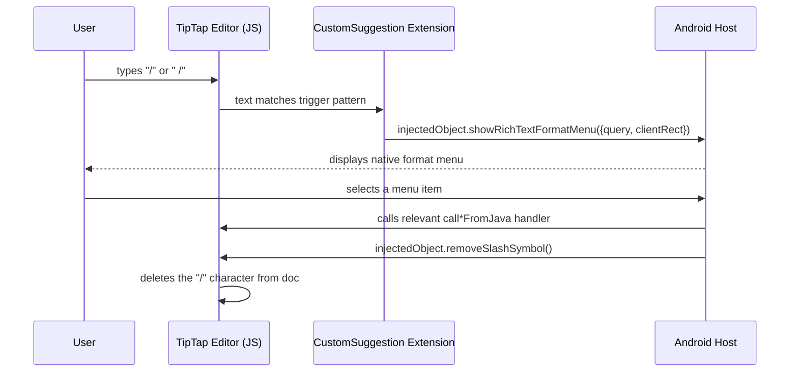
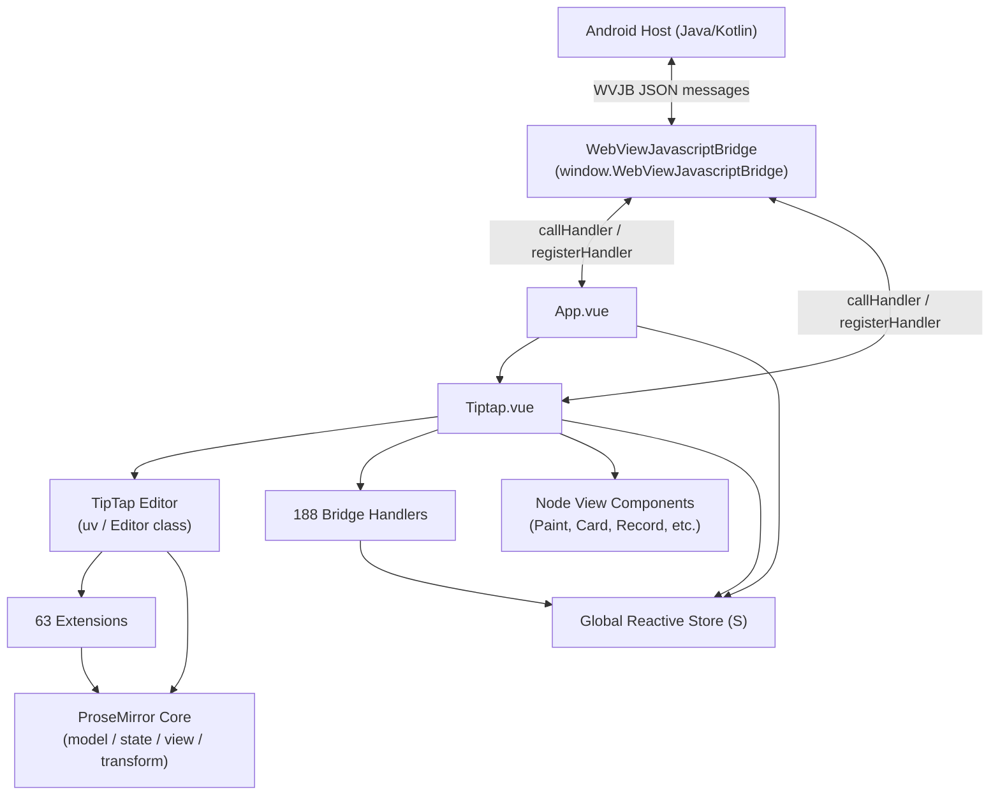

# ColorOS Notes — TipTap Editor Architecture

> Reverse Engineering Investigation Report  
> Status: Active · Last Updated: 2026-10-31

---

## 1. Overview

The ColorOS Notes editor is a **Vue 3 single-page application** embedded inside a WebView on Android. The editor is powered by **TipTap v2** (built on ProseMirror), with a custom **WebViewJavascriptBridge** (WVJB) layer that provides bidirectional communication between the JavaScript editor and the native Android host.

The editor is delivered as pre-bundled ES module chunks. The main bundle (`assets/index.js`) bootstraps Vue and registers bridge handlers. The existing inventory identifies 63 extension candidates and 21 Vue component names; not every extension's kind/configuration or every component's render-tree placement is independently verified. The bundle has 188 JS-registered Android→JS handlers; the Android proxy separately exposes 107 JS→Android `@JavascriptInterface` methods.

## 1.1 Verified Audit and Corrections

This subsection is the controlling evidence audit for this report. Source paths are workspace-relative. The editor bundle is minified and mostly one long line; JavaScript references below therefore use bundle line 1 plus the character offset recorded by `apk-work/rea-tools/extract_bridge.py`. Offsets are source-string offsets, not REA node IDs.

- [VERIFIED] `index.html` loads `./assets/index.js` as an ES module and preloads the Vue, TipTap, ProseMirror, HTML parser, `html2canvas`, Lottie, phone-number, and utility chunks. It contains only `<div id="app"></div>` as its mount element. Source: `apk-work/extracted/assets/tiptap/index.html:8-31`.
- [VERIFIED] The existing component inventory detects 21 Vue component names, including `App`, `Tiptap`, `Paint`, `Paint2`, `Record`, `Card`, `ContactCard`, `ScheduleCard`, `FileCard`, `VideoCard`, `HorizontalRule`, `ProgressiveImage`, `AigcText`, and `SummaryStreamTip`. The inventory is `apk-work/rea-tools/editor_components_inventory.json`; component names alone do not prove their exact rendered nesting.
- [VERIFIED] The editor bundle contains 188 `registerHandler` registrations (counted by `extract_bridge.py`). A separate Android proxy exposes 107 `@JavascriptInterface` methods in `com/oplus/notes/webview/cache/a.java`; exact-name search finds 99 of those method names in `index.js`. These are different interface directions and must not be added as one handler total. Eight proxy methods have no direct string reference in this bundle; absence of a match does not prove they are unused through reflection or another component.
- [VERIFIED] The Android bridge transport is `WVJBWebView`: it exposes `WVJBInterface.notice(String)` and posts messages into its handler (`WVJBWebView.java:114-120`), installs the interface (`:437`), serializes native messages to `WebViewJavascriptBridge._handleMessageFromJava(...)` (`:703`), and invokes `evaluateJavascript` (`:722`). The proxy sends `callInitContentFromJava` / `callUpdateContentFromJava` in `com/oplus/notes/webview/container/web/g.java:168-190`.
- [VERIFIED] The primary note body is sent as `tiptapContentJson` when available; the native payload has ten fields (`guid`, `titleHintText`, `title`, `content`, `subAttachments`, `pageResults`, `pictureAttrs`, `tiptapTitleJson`, `tiptapContentJson`, `isDoingSummary`). Source: `com/oplus/notes/webview/data/TiptapContentInfo.java:24-37, 129-149`; the Kotlin data class stores several JSON-shaped fields as strings, not parsed arrays/objects.
- [VERIFIED] The `callInitContentFromJava` handler parses the payload, sets the note GUID, parses `tiptapContentJson` when non-null, and is registered inside `Fa()` in `index.js` at offset 817407. `callUpdateContentFromJava` parses attachment/page/picture metadata and replaces content through its handler at offset 612422. Legacy-HTML conversion is present in the bundle, but the prior `Ma()` name is not revalidated in this audit and should be treated as [UNKNOWN] until its definition/call is located.
- [VERIFIED] `onContentJsonUpdate(String)` updates the fragment ViewModel’s TipTap body JSON (`WVNoteViewEditFragment.java:17283-17289`). The callback is a native persistence/model handoff; the fragment excerpt does not itself prove a disk write on every keystroke.
- [UNKNOWN] The bundle was not launched in Chromium during this investigation. Standalone rendering, startup ordering, required globals, and local-asset behavior are static findings only; see `STANDALONE_EDITOR_FEASIBILITY.md`.

The earlier prose in this report that calls the full editor “runnable in any browser,” states that every extension/function is verified, or assigns an exact component parent/child hierarchy exceeds the evidence. Treat those claims as hypotheses, not conclusions. REA explicitly marks graph coverage partial and states that static imports and relationships do not prove execution.

---

## 2. Bundle Structure & Files

All assets are served from the `assets/` directory. [VERIFIED from filesystem]

| File | Size | Purpose |
|---|---|---|
| `assets/index.js` | 823 KB | Main app bundle — Vue components, TipTap setup, bridge handlers |
| `assets/index.css` | 115 KB | All component styles |
| `assets/@vue.js` | 72 KB | Vue 3 runtime chunk |
| `assets/@tiptap.js` | 66 KB | TipTap core (`Editor` class, built-in extensions) |
| `assets/prosemirror-model.js` | — | ProseMirror document model |
| `assets/prosemirror-state.js` | — | ProseMirror editor state |
| `assets/prosemirror-view.js` | — | ProseMirror DOM view |
| `assets/prosemirror-transform.js` | — | ProseMirror transforms / transactions |
| `assets/prosemirror-tables.js` | — | Table editing support |
| `assets/prosemirror-keymap.js` | — | Keyboard mapping |
| `assets/prosemirror-commands.js` | — | Built-in editing commands |
| `assets/prosemirror-schema-list.js` | — | List schema helpers |
| `assets/html2canvas.js` | 198 KB | HTML-to-image rendering (used by paint/export) |
| `assets/lottie-web.js` | 301 KB | Lottie animation player |
| `assets/libphonenumber-js.js` | 131 KB | Phone number parsing (used by `CustomPhoneHint`) |

> [!NOTE]
> Individual `prosemirror-*.js` chunk sizes were not captured during analysis. All ProseMirror packages listed above are [VERIFIED] from import analysis.

---

## 3. App Initialization Sequence

Each step is labeled [VERIFIED] or [INFERRED].

1. **HTML document loads** — The host WebView loads the HTML shell. `<script type="module">` triggers browser-style ES module loading. [VERIFIED]
2. **Chunk preloading** — All dependency chunks (`@vue.js`, `@tiptap.js`, `prosemirror-*.js`, etc.) are preloaded via `<link rel="modulepreload">` or dynamic imports resolved at bundle time. [INFERRED]
3. **IIFE bootstraps** — An Immediately Invoked Function Expression at the end of `assets/index.js` runs and sets up `window.WebViewJavascriptBridge`:
   - If `window.WebViewJavascriptBridge` is absent, creates it with a `Map`-based handler registry.
   - Outbound messages route to `window.WVJBInterface.notice(jsonString)` (primary) or `prompt("_wvjbxx", jsonString)` (fallback). [VERIFIED]
4. **`window.close` monkey-patched** — `window.close` is overwritten: `() => bridge.callHandler("_closePage")` so page-close calls route through the bridge to Android. [VERIFIED]
5. **Vue app mounts** — `Zc.mount("#app")` mounts `App.vue` on the `<div id="app">` element. (`Zc` is the Vue `createApp` result.) [VERIFIED from index.js]
6. **`App.vue` `setup()` runs** — Registers the `callAttachTipTapFromJava` bridge handler (used by Android to attach/detach the editor). [VERIFIED]
7. **`App.vue` `onMounted` fires** — Calls `window.injectedAppVueObject?.onAppVueMounted()`. Android responds with `{ colorOSVersion: N }` identifying the OS version. [VERIFIED]
8. **`Tiptap.vue` renders** — The `Tiptap` component is mounted as a child of `App`. It instantiates `new uv({ extensions: [...], editorProps: {...} })` — `uv` is `B as uv` imported from `@tiptap.js`, i.e., the TipTap `Editor` class. All **63 extensions** are passed here. [VERIFIED]
9. **Bridge registration** — the inventory finds 188 handler registrations in `index.js`; their registration block is in the minified bundle at line 362, with additional lifecycle registrations at line 534. Exact component ownership for every registration is not established by the inventory.
10. **Editor ready signal** — After the TipTap `Editor` emits its `create` event, the component calls `injectedObject.onTipTapMounted()` to notify Android. [VERIFIED]
11. **Content load** — Android calls `callInitContentFromJava` with a `TiptapContentInfo` JSON payload. The editor parses it and loads the document. [VERIFIED]

---

## 4. Vue Component Tree

The following 21 Vue components were identified via `__name` patterns in `index.js`. [VERIFIED]

```mermaid
flowchart TD
    App["App.vue (root)"]
    Tiptap["Tiptap.vue (editor host)"]
    Paint["Paint.vue (drawing canvas v1)"]
    Paint2["Paint2.vue (drawing canvas v2)"]
    Record["Record.vue (audio recording)"]
    Card["Card.vue (link/web card)"]
    ContactCard["ContactCard.vue"]
    ScheduleCard["ScheduleCard.vue"]
    FileCard["FileCard.vue"]
    VideoCard["VideoCard.vue"]
    HorizontalRule["HorizontalRule.vue"]
    ProgressiveImage["ProgressiveImage.vue"]
    ImageCustomEmptyView["ImageCustomEmptyView.vue"]
    BlockViewWrapperComponent["BlockViewWrapperComponent.vue"]
    AigcText["AigcText.vue (AI text block)"]
    SummaryStreamTip["SummaryStreamTip.vue (AI summary)"]
    CanvasGridBackground["CanvasGridBackground.vue"]
    DotMatrixBackground["DotMatrixBackground.vue"]
    DynamicPaperBackground["DynamicPaperBackground.vue"]
    HorizontalLinesBackground["HorizontalLinesBackground.vue"]

    App --> Tiptap
    Tiptap --> Paint
    Tiptap --> Paint2
    Tiptap --> Record
    Tiptap --> Card
    Tiptap --> ContactCard
    Tiptap --> ScheduleCard
    Tiptap --> FileCard
    Tiptap --> VideoCard
    Tiptap --> HorizontalRule
    Tiptap --> ProgressiveImage
    Tiptap --> ImageCustomEmptyView
    Tiptap --> BlockViewWrapperComponent
    Tiptap --> AigcText
    Tiptap --> SummaryStreamTip
    App --> CanvasGridBackground
    App --> DotMatrixBackground
    App --> DynamicPaperBackground
    App --> HorizontalLinesBackground
```



> [!NOTE]
> The parent-child relationships above (other than App → Tiptap) are [INFERRED] from the logical role of each component. The exact render-tree nesting within `Tiptap.vue` node views may differ.

---

## 5. TipTap Extensions Reference

All 63 extensions registered in `new uv({ extensions: [...] })`. [VERIFIED unless noted]

| Variable | Name | Kind | Description | Config / Notes |
|---|---|---|---|---|
| `GR` | _(Document root)_ | Node | Document root node; wraps all block content | `content: "block*"` · Extended from `lv` (TipTap `Document`) |
| `LT` | `heading` | Node | Custom heading node | Overrides built-in via `Ke.create` |
| `Cu` | `paragraph` | Node | Paragraph block | Custom via `Ke.create` |
| `hv` | _(TaskList wrapper)_ | — | Standard TipTap TaskList import | `draggable: true` |
| `Pn` | `textStyle` | Mark | Inline text style container | Extended via `As.create` |
| `F_` | `fontSize` | Extension | Font size control | Via `je.create` |
| `j_` | `fontFamily` | Extension | Font family control | Via `je.create` |
| `KR` | `fontWeight` | Extension | Font weight control | Via `je.create` |
| `U_` | `color` | Mark | Inline text color | Via `je.create` |
| `J_` | `backgroundColor` | Mark | Inline background color | Via `je.create` |
| `eb` | `strike` | Mark | Strikethrough | Extended from built-in |
| `Sa` | `underline` | Mark | Underline | `class="note-underline"` |
| `rT` | `superscript` | Mark | Superscript | `class="note-superscript"` |
| `aT` | `subscript` | Mark | Subscript | `class="note-subscript"` |
| `iT` | `bold` | Mark | Bold | Custom override |
| `UT` | `italic` | Mark | Italic | Custom override |
| `s$` | `link` | Mark | Hyperlink | `openOnClick: false`, `linkOnPaste: false` |
| `ZA` | `characterCount` | Extension | Character & word count | Via `je.create` |
| `lh` | `textAlign` | Extension | Text alignment | `types: ["heading","paragraph"]`, `alignments: ["start","center","end"]` |
| `Ba` | `listItem` | Node | Standard list item | Custom via `Ke.create` |
| `YL` | `taskItem` | Node | Checkbox task item | Custom via `Ke.create` |
| `jR` | `listKeymap` | Extension | List keyboard shortcuts | Via `je.create` |
| `qR` | `list-item-marker` | Extension | Custom bullet/number marker rendering | Via `je.create` |
| `DR` | `bulletList` | Node | Unordered list | Custom via `Ke.create` |
| `I$` | `bulletListHX` | Node | Heading-level bullet list | Custom node — non-standard |
| `FR` | `orderedList` | Node | Ordered/numbered list | Custom via `Ke.create` |
| `GL` | `taskList` | Node | Task list container | Custom via `Ke.create` |
| `mr` | `image` | Node | Inline image | `allowBase64: true` |
| `Sr` | `videoCard` | Node | Embedded video card | Custom node |
| `gr` | `card` | Node | Link / web preview card | Custom node |
| `Tr` | `contactCard` | Node | Contact info card | Custom node |
| `br` | `scheduleCard` | Node | Calendar/schedule card | Custom node |
| `vr` | `record` | Node | Audio recording block | Custom node |
| `yr` | `filecard` | Node | File attachment card | Custom node |
| `Ra` | `paint` | Node | Drawing canvas block (v1) | Custom node |
| `Ah` | `paint` | Node | Drawing canvas block (variant/v2) | Custom node — duplicate name [INFERRED variant] |
| `cn` | `horizontalRule` | Node | Horizontal divider line | Custom via `Ke.create` |
| `hP` | `smart-text-replace-marker` | Extension | Smart quote / text replacement markers | Via `je.create` |
| `tb` | `textIndent` | Extension | Text indentation | `types: ["heading","paragraph","listItem","taskItem"]` |
| `Cp` | `blockquote` | Node | Block quote | Custom via `Ke.create` |
| `ng` | `MultiHeading` | Extension | Multi-level heading marks | Via `je.create` |
| `T$` | `searchAndReplace` | Extension | In-editor find & replace | Via `je.create` |
| `G1` | `CustomPhoneHint` | Node | Phone number detection & hint | Uses `libphonenumber-js` |
| `Nk` | `SummaryStreamTip` | Node | AI summary streaming block | Custom node |
| `Wx` | `aigcText` | Node | AI-generated text block | Custom node |
| `w$` | `customHistory` | Extension | Custom undo/redo stack | Replaces built-in History |
| `$E` | `ObserveTitleHistoryExtension` | Extension | Title field undo observer | Via `je.create` |
| `_$` | `customCommands` | Extension | Custom editor command set | Via `je.create` |
| `k$` | `clipboardEventHandlerPlugin` | Extension | Clipboard paste/cut handling | Via `je.create` |
| `M$` | _(autoKoreanJapanese)_ | Extension | CJK IME composition fix | Via `je.create` |
| `kT` | `table` | Node | Table block | `resizable: true` |
| `m1` | `tableRow` | Node | Table row | Custom via `Ke.create` |
| `p1` | `tableCell` | Node | Table cell | Custom via `Ke.create` |
| `H$` | `attachTrailingNode` | Extension | Ensures a trailing paragraph always exists | Via `je.create` |
| `W$` | `small-pic-one-line-extension` | Extension | Small image single-line layout | Via `je.create` |
| `Y$` | `Paint2NeighborExtension` | Extension | Logic for nodes adjacent to paint blocks | Via `je.create` |
| `mP` | `CustomEmptyNode` | Node | Placeholder / empty block node | Custom via `Ke.create` |
| `z$` | `CustomDropCursor` | Extension | Drag-and-drop cursor indicator | Via `je.create` |
| `nP` | `BlockClipBoardPlugin` | Extension | Block-level clipboard operations | Via `je.create` |
| `U$` | `blockExtension` | Extension | Block selection mode | Via `je.create` |
| `nE` | `imageSizeHelper` | Extension | Image resize UI helper | Via `je.create` |
| `VL` | `CustomPlaceholder` | Extension | Editor body placeholder text | Via `je.create` |
| `KE` | `CustomSuggestion` | Extension | Slash command (`/`) suggestion menu | Via `je.create` |

---

## 6. ProseMirror Document Schema

The schema is assembled from TipTap's extension system, which wraps ProseMirror's `Schema` constructor. [VERIFIED package imports; schema shape INFERRED from extensions]

### Nodes

| Node Name | Description |
|---|---|
| `doc` | Root document node (`content: "block*"`) |
| `paragraph` | Standard paragraph |
| `heading` | Heading (custom, replaces built-in) |
| `bulletList` | Unordered list wrapper |
| `bulletListHX` | Heading-level bullet list (custom) |
| `orderedList` | Ordered list wrapper |
| `listItem` | List item |
| `taskList` | Task list wrapper |
| `taskItem` | Checkbox task item |
| `blockquote` | Block quote |
| `horizontalRule` | `<hr>` divider |
| `table` | Table (resizable) |
| `tableRow` | Table row |
| `tableCell` | Table cell |
| `image` | Image (base64 allowed) |
| `videoCard` | Video embed card |
| `card` | Link preview card |
| `contactCard` | Contact card |
| `scheduleCard` | Calendar card |
| `record` | Audio recording block |
| `filecard` | File attachment card |
| `paint` | Drawing canvas block |
| `CustomPhoneHint` | Phone number hint inline block |
| `SummaryStreamTip` | AI summary streaming block |
| `aigcText` | AI-generated text block |
| `CustomEmptyNode` | Empty/placeholder block |

### Marks

| Mark Name | Description |
|---|---|
| `textStyle` | Container for inline style marks |
| `bold` | Bold (`<strong>`) |
| `italic` | Italic (`<em>`) |
| `strike` | Strikethrough (`<s>`) |
| `underline` | Underline (`class="note-underline"`) |
| `superscript` | Superscript (`class="note-superscript"`) |
| `subscript` | Subscript (`class="note-subscript"`) |
| `color` | Text foreground color |
| `backgroundColor` | Text background color |
| `link` | Hyperlink (no auto-open, no paste-detect) |

---

## 7. Reactive State Management

The global reactive store is accessed throughout `index.js` via an object identified as **`S`**. It is created using Vue's `reactive()` or `ref()` primitives. [INFERRED from usage patterns]

| Field | Type | Description |
|---|---|---|
| `editorUiMode.value` | String/Enum | Current UI mode (e.g., normal, overlay, quick-note) |
| `isQuickNote.value` | Boolean | Whether editor is in Quick Note mode |
| `shouShowCard.value` | Boolean | Whether a card picker UI should be shown |
| `isInitialDataLoad.value` | Boolean | True during the first content load from Android |
| `switchingToOverlayMode.value` | Boolean | True while transitioning to overlay mode |
| `pasteResult` | Any | Holds the last paste operation result |
| `aigcAttachSelectionMap` | Map | Maps AIGC attachment IDs to selection ranges |
| `multiHeading1Holder.value` | Any | Holds state for multi-level heading rendering |
| `dragTextInfo` | Object | Metadata for the current drag-and-drop text operation |
| `isUseAigcFunction` | Boolean | Feature flag: whether AI (AIGC) features are enabled |

> [!NOTE]
> All field names above are [INFERRED] from their usage patterns in `index.js`. The actual object name `S` and field spelling may differ from source variable naming before minification.

---

## 8. Content Serialization

The editor uses **TipTap JSON (ProseMirror document JSON)** as its primary storage format, with HTML as an export/legacy format.

### Primary Format: TipTap JSON

- Every editor change triggers `injectedObject.onContentJsonUpdate(jsonString)` where `jsonString` is the full ProseMirror document serialized to JSON. [VERIFIED]
- On load, if `tiptapContentJson` is present in `TiptapContentInfo`, it is preferred over raw HTML. [VERIFIED]

### TiptapContentInfo JSON Payload (sent by Android on init) [VERIFIED from `TiptapContentInfo.kt`]

```json
{
  "guid": "string — note UUID",
  "titleHintText": "string — placeholder for the title field",
  "title": "string — raw legacy title text",
  "content": "string — raw HTML/legacy format body (empty if tiptapContentJson present)",
  "subAttachments": "string — JSON array of attachment metadata",
  "pageResults": "string — JSON array of web card page results",
  "pictureAttrs": "string — JSON array of image attributes",
  "tiptapTitleJson": "string | null — TipTap JSON for the title field",
  "tiptapContentJson": "string | null — TipTap JSON for the body (preferred over content)",
  "isDoingSummary": "boolean — true if an AI summary is in progress"
}
```

### Serialization Endpoints (Bridge Calls)

| Bridge Handler | Direction | Returns | Notes |
|---|---|---|---|
| `callInitContentFromJava` | Android → JS | — | Delivers `TiptapContentInfo` JSON; triggers document load |
| `onContentJsonUpdate` | JS → Android | — | Fired on every editor change; sends full doc JSON |
| `callGetAllHTMLFromJava` | Android → JS | HTML string | Full document as HTML via callback |
| `callGetTextAndHtmlFromJava` | Android → JS | `{text, htmlData:{content}, textIncludePaint}` | Plain text + HTML |
| `callGetAttachmentsFromJava` | Android → JS | JSON array | Attachment list via `GM(editor)` |

### Legacy Content Migration [VERIFIED]

When `tiptapContentJson` is absent, `Ma(guid, rawHtml, subAttachments, pageResults, pictureAttrs)` is called. This function uses **htmlparser2** to parse the old HTML format and converts it to TipTap JSON in-place.

---

## 9. Slash Command System

The slash command system allows users to type `/` in the editor to invoke a native Android format menu. [VERIFIED]

**Trigger:** Typing `/` or ` /` (space + slash) in any text position.

**Flow:**



**Key details:**
- `query` is the text typed after `/` (for filtering menu items). [INFERRED]
- `clientRect` provides the caret's screen position so Android can anchor the menu. [INFERRED]
- `removeSlashSymbol()` is called by Android regardless of whether an item was selected, to clean up the trigger character. [VERIFIED]

---

## 10. Dependency Map



---

## 11. Limitations & Unknowns

| Item | Status | Notes |
|---|---|---|
| Exact parent/child nesting of all Vue components | [UNKNOWN] | Only top-level `__name` registrations were found; full render tree not traced |
| Complete 188 handler payload/callback contracts | [UNKNOWN] | All handler names are cataloged in `BRIDGE_API_REFERENCE.md`; many payload schemas and exact host call sites remain unresolved |
| `S` (global store) exact structure | [INFERRED] | Field names derived from usage; original source names pre-minification unknown |
| `paint` node duplicate (`Ra` vs `Ah`) | [INFERRED] | Two variables share the name `"paint"` — likely v1/v2 variants; exact distinction unknown |
| `autoKoreanJapanesePlugin` (`M$`) exact name | [INFERRED] | Variable name from config key, not a string `name` field |
| ProseMirror schema mark/node attribute details | [UNKNOWN] | Full `attrs` definitions not extracted from minified source |
| `TiptapContentInfo` fields beyond those in `.kt` | [UNKNOWN] | Additional undocumented fields may exist |
| Lottie animation usage context | [UNKNOWN] | `lottie-web.js` is bundled but which component uses it is not confirmed |
| `html2canvas.js` invocation | [INFERRED] | Likely used by Paint node export or screenshot feature |
| Bridge transport on non-Android platforms | [INFERRED] | `prompt("_wvjbxx", ...)` fallback suggests possible iOS WKWebView compatibility |
